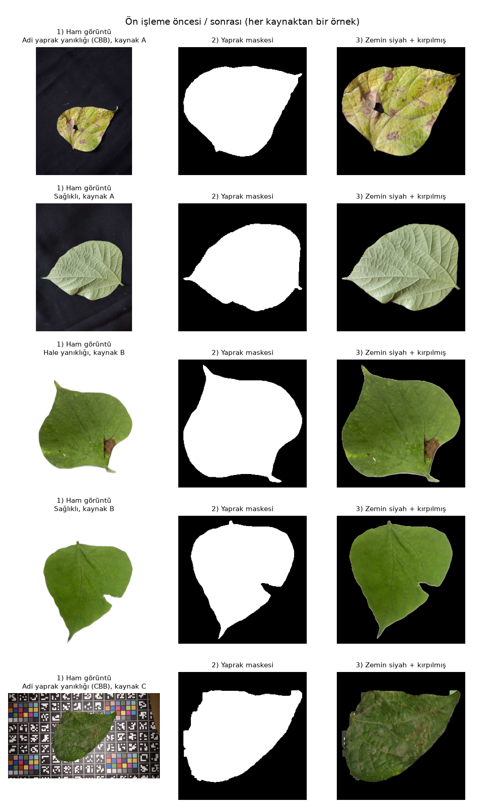
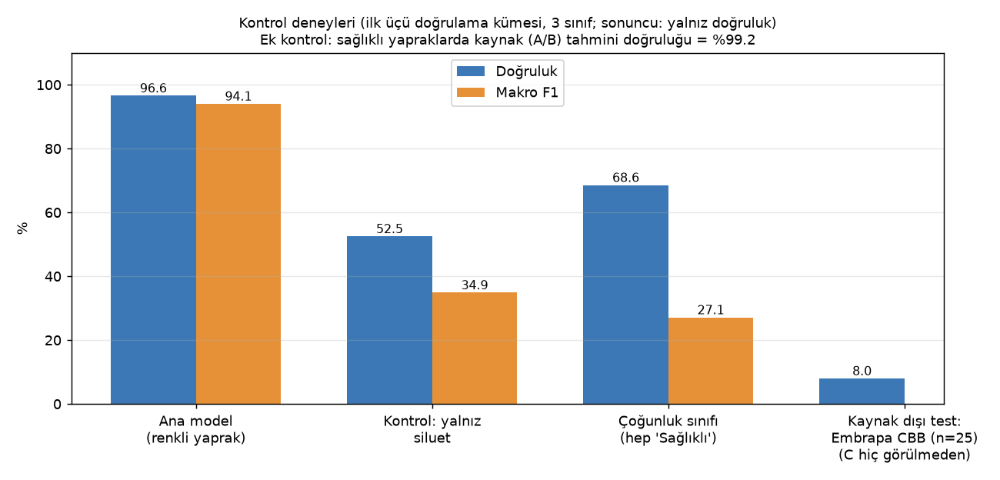
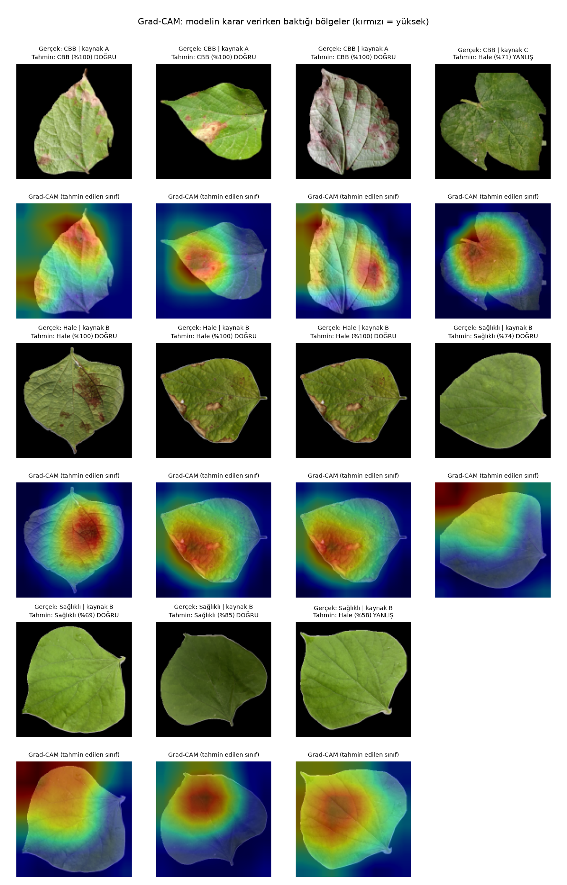
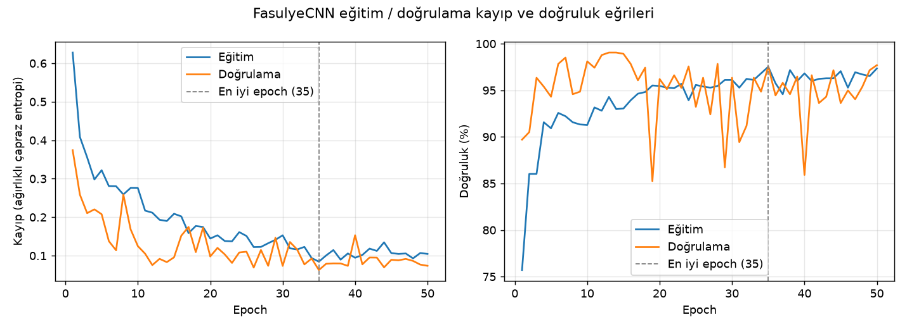
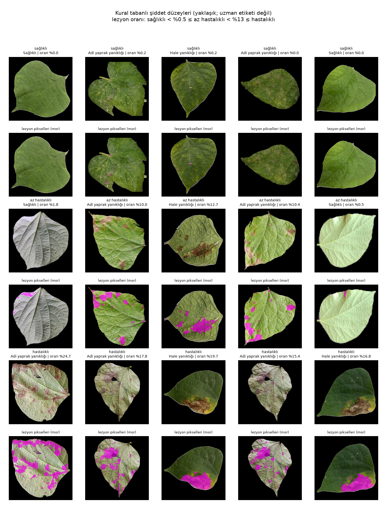

# Bean leaf disease classification with a from-scratch CNN

[](https://github.com/alisimsek55/bean-leaf-disease-cnn/actions/workflows/tests.yml)

[Türkçe](README.tr.md)

A 16-layer convolutional neural network, designed and trained from scratch in PyTorch, that classifies bean leaf photos as common bacterial blight (CBB), halo blight, or healthy. It was built as a university "AI in Agriculture" course project. It reaches 96.6% validation accuracy on a split that passes a burst-frame leakage audit (the first split leaked and gave 97.6%; see [Results](#results)). The more interesting part of the repository is what happened after that number came out: I tested how much of it reflects disease recognition and how much reflects dataset artifacts, and the answer is "less than the headline suggests".



*One example from each source/class combination: raw image, leaf mask, and the cropped, background-blackened image the model sees.*

## Results

Validation set, n = 735 images (70/30 split grouped by near-duplicate and burst groups, see [Split](#split)). Source: [`ciktilar/metrikler.json`](ciktilar/metrikler.json).

| Metric | Value |
|---|---|
| Accuracy | 96.60% (710/735) |
| Balanced accuracy | 97.23% |
| Macro F1 | 94.06% |
| Majority-class baseline (always "healthy") | 68.6% accuracy, 27.1% macro F1 |

| Class | Precision | Recall | F1 | n |
|---|---|---|---|---|
| Common bacterial blight (CBB) | 1.000 | 0.969 | 0.984 | 162 |
| Halo blight | 0.764 | 0.986 | 0.861 | 69 |
| Healthy | 0.992 | 0.962 | 0.977 | 504 |

Confusion matrix (rows = true, columns = predicted: CBB, halo, healthy): CBB `[157, 2, 3]`, halo `[0, 68, 1]`, healthy `[0, 19, 485]`.

| Subset (class, source) | n | Correct | Accuracy | Errors went to |
|---|---|---|---|---|
| CBB, source A | 154 | 154 | 100% | – |
| CBB, source C (Embrapa) | 8 | 3 | 37.5% | 2 halo, 3 healthy |
| Halo, source B | 69 | 68 | 98.6% | 1 healthy |
| Healthy, source A | 160 | 160 | 100% | – |
| Healthy, source B | 344 | 325 | 94.5% | 19 halo |

There is no separate test set: the validation set was also used for early stopping and model selection, so these numbers are somewhat optimistic even before the checks below.

### The first split leaked burst frames

The first committed split kept every dHash near-duplicate group on one side, but an audit ([`scripts/bolme_denetimi.py`](scripts/bolme_denetimi.py)) later found that burst frames of the same leaf in source A had been split across train and validation: 145 capture-seconds appeared on both sides, and 299 of the 314 source-A validation images (40.5% of that 738-image validation set) had a frame from the same second in training (312 of 314 with a 2-second burst window). The split was rebuilt with burst-aware groups and every model was retrained; the audit now finds 0 shared groups, files, capture-seconds and bursts.

| | Previous split, with burst leakage | Current split, leak-free by the audit |
|---|---|---|
| Train / validation images | 1,713 / 738 | 1,716 / 735 |
| Accuracy | 97.56% (720/738) | 96.60% (710/735) |
| Macro F1 | 95.48% | 94.06% |
| Balanced accuracy | 98.68% | 97.23% |
| Source A (all) | 100% (314/314) | 100% (314/314) |
| Source B (all) | 95.9% | 95.2% (393/413) |
| Source C (CBB) | 7/8 | 3/8 |

The headline dropped by about one point, but not where the leakage was: source A is 100% on both splits, so in this run the burst leakage did not visibly inflate the source-A result. The drop comes from source C (7/8 to 3/8) and from source B healthy leaves. With a single seed, different validation sets and two code changes between the runs (see [Reproduce](#reproduce)), a one-point difference cannot be attributed to the leakage fix. Note also that the 314 source-A validation images now come from only 33 independent bursts (16 CBB, 17 healthy), so "100% on source A" rests on 33 leaves.

## Is the accuracy real?

Almost every class comes from a different data source with a different background (details under [Data](#data)): all halo blight images come from source B, 95% of CBB images from source A. A network can score well by recognising the source instead of the disease. I ran four checks, all on the leak-free split.

| Check | What was done | Result | What it shows |
|---|---|---|---|
| Silhouette only | Same architecture, split and settings, but the input is only the leaf outline (flat gray inside, black outside; no color or texture) | 52.5% accuracy, 34.9% macro F1 (majority baseline: 68.6%) | Leaf shape alone does not explain the result. |
| Source prediction | Same CNN on the masked healthy leaves only, target = data source (A vs B) | 99.2% (500/504; A 159/160, B 341/344) | Masking removed the background but not the source signature (lighting, camera, leaf side, edge artifacts). Because halo = source B and CBB is about 95% source A, the CBB vs halo distinction cannot be separated from source identity. |
| Unseen source (Embrapa) | Source C removed from training and validation, model retrained, then tested on the 27 Embrapa images (expert-labelled *Phaseolus vulgaris*) | 2/25 CBB correct (8%): 13 called halo, 10 called healthy. 2/2 healthy correct. The same model scored 99.04% accuracy on the A+B validation set. | Generalization to a source the model has not seen is very weak. n is small (25 CBB leaves). |
| Grad-CAM | Last conv layer (8x8), predicted class, over all 735 validation images | Median CAM-weight enrichment on lesion pixels: 1.43x (CBB), 2.70x (halo); about 1x on the leaf edge. 34-43% of CAM weight still lands on the black background. | The model does look at lesions, but this cannot tell whether it uses disease-specific features or source-specific lesion appearance. The 8x8 map is also coarse. |





**Conclusion.** Distinguishing diseased from healthy leaves within the same source looks plausible: the background is removed, the silhouette is not enough, the model attends to lesions, and source A stays at 100% after the burst leakage was removed (on only 33 independent validation bursts). Sources B and C have no capture timestamps in their file names, so for them only the dHash grouping applies and burst leakage can be neither detected nor ruled out by the audit. For healthy leaves, 100% of source A and 94.5% of source B were classified correctly, and all 19 errors (source B) went toward halo blight. The CBB vs halo blight distinction cannot be shown to come from the disease, because class and source overlap almost completely, and the two-in-twenty-five result on unseen-source CBB leaves says the 96.6% is an in-distribution (same sources) figure.

An optional ImageNet-pretrained EfficientNet-B0 (fine-tuned, 4,011,391 parameters) reached 100% validation accuracy (735/735) on the leak-free split, as it did on the leaky one. The same source overlap applies, so this is not evidence of disease recognition either. The unseen-source test was not run for it.

## Pipeline

### Data

Three public sources, 2,460 images in total (CBB 533, halo blight 231, healthy 1,696). Labels are the dataset authors' labels and were not changed. Full details: [docs/DATASET.tr.md](docs/DATASET.tr.md) (Turkish).

| Source | Content used | Background |
|---|---|---|
| A: Mendeley Data, Rashid et al. | CBB 508, healthy 549 | Phone photos on black/dark cloth |
| B: Mendeley Data, Mojumdar et al. | Halo blight 231, healthy 1,145 | Background removed (white), PNG |
| C: Embrapa PDDB, Barbedo et al. | CBB 25, healthy 2 (one leaf) | Color calibration card, expert-labelled *P. vulgaris* |

Nine images with failed masks (all source A, healthy) were excluded, leaving 2,451.

| Class | Train | Validation | Total |
|---|---|---|---|
| CBB | 371 | 162 | 533 |
| Halo blight | 162 | 69 | 231 |
| Healthy | 1,183 | 504 | 1,687 |
| Total | 1,716 | 735 | 2,451 |

Many images are near-identical frames of the same leaf. After grouping near-duplicates and bursts, the 2,451 images form 668 groups: CBB 78 (54 train / 24 validation), halo blight 146 (95 / 51), healthy 444 (310 / 134).

### Preprocessing

[`src/01_on_isleme.py`](src/01_on_isleme.py). The goal is to stop the model from learning the background (white PNG vs black cloth vs calibration card). A leaf mask is computed per source (HSV thresholding for the white background; GrabCut seeded by Otsu and Lab chroma for the cloth; a hue seed plus GrabCut for the calibration card), cleaned with morphology and the largest connected component, and everything outside the leaf is painted black. Images are cropped to the leaf bounding box, padded to a square and saved as 256x256 PNG; the model reads them at 128x128. The first two masking attempts failed on the cloth images and were replaced; the final one was checked by eye on contact sheets. Known defects remain (small calibration-card fragments in some source C images, a little cloth residue in a few source A images).

### Split

[`src/02_veri_bolme.py`](src/02_veri_bolme.py). 70% train / 30% validation, grouped and stratified by (class, source); groups are shuffled with seed 42 and added to validation until each stratum is closest to 30%. No samples were discarded to balance classes. A group ([`scripts/yakin_kopya.py`](scripts/yakin_kopya.py)) joins images that are near-duplicates (256-bit dHash, Hamming distance <= 20) or burst frames: source-A file names carry the capture time (`IMG_<date>_<time>_<ms>`), and frames of the same source and class at most 2 seconds apart are chained into one group. dHash alone was not enough: consecutive burst frames of the same leaf often differ by more than the threshold, and the first split built on dHash groups leaked (see [Results](#the-first-split-leaked-burst-frames)). With bursts merged, source A drops from 1,056 dHash groups to 110 (CBB 53, healthy 57). The audit [`scripts/bolme_denetimi.py`](scripts/bolme_denetimi.py) finds no shared group, file, capture-second or 2-second burst between train and validation in the current split.

| Class, source | Train | Validation |
|---|---|---|
| CBB, A | 354 (37 groups) | 154 (16 groups) |
| CBB, C | 17 (17 groups) | 8 (8 groups) |
| Halo, B | 162 (95 groups) | 69 (51 groups) |
| Healthy, A | 380 (40 groups) | 160 (17 groups) |
| Healthy, B | 801 (269 groups) | 344 (117 groups) |
| Healthy, C | 2 (1 group) | 0 |

### Model

[`src/03_model.py`](src/03_model.py). No pretrained weights; He initialization. 1,772,995 trainable parameters.

| Layers | Description | Output |
|---|---|---|
| 1-3 | Conv 4x4, 32, BatchNorm, ReLU; MaxPool 2x2; Dropout 0.2 | 64x64x32 |
| 4-6 | Conv 4x4, 64, BN, ReLU; MaxPool; Dropout 0.2 | 32x32x64 |
| 7-9 | Conv 4x4, 128, BN, ReLU; MaxPool; Dropout 0.2 | 16x16x128 |
| 10-12 | Conv 4x4, 256, BN, ReLU; MaxPool; Dropout 0.2 | 8x8x256 |
| 13 | Conv 4x4, 256, BN, ReLU (Grad-CAM layer) | 8x8x256 |
| 14 | Global average pooling | 256 |
| 15 | Dense 128, ReLU, Dropout 0.3 | 128 |
| 16 | Dense 3 (softmax in the loss) | 3 |

Input is 128x128x3. Layers are counted Keras-style, with BatchNorm folded into the convolution layer.

### Training

[`src/04_egitim.py`](src/04_egitim.py).

| Setting | Value |
|---|---|
| Loss | Class-weighted cross-entropy, w = N/(K*n_c): 1.542 / 3.531 / 0.484 (CBB / halo / healthy) |
| Optimizer | AdamW, lr 1e-3, weight decay 1e-4, batch 32 |
| Schedule | ReduceLROnPlateau (x0.5 after 5 epochs without validation-loss improvement) |
| Stopping | Max 100 epochs; early stopping after 15 epochs without improvement; best validation loss kept |
| Augmentation (train only) | Flips, 0-360 degree rotation, random resized crop, brightness/contrast/saturation/hue jitter; background re-blackened after augmentation |
| Seed | 42, deterministic cuDNN |

It ran 26 epochs; the best epoch was 11 (validation loss 0.0874, training accuracy 91.0% at that epoch). Class-weighted loss and augmentation were preferred over undersampling the healthy class because the data is small and healthy comes from two sources.



### Severity estimate

[`src/06_siddet_tahmini.py`](src/06_siddet_tahmini.py). **This is a rule-based estimate, not an expert label**; the datasets have no severity annotation. Within the eroded leaf mask, a pixel counts as lesion if it is reddish/brown (Lab a* - 128 > 4), yellow-orange (H < 27 and S > 60), or very dark (V < 45). The lesion ratio is split by two thresholds chosen by looking at the data: T1 = 0.5% (about the 99th percentile of healthy leaves) and T2 = 13% (median of the CBB and halo classes). Below T1 is "healthy", from T1 up to (not including) T2 "mildly diseased", at or above T2 "diseased".

Counts over the 2,451 images: healthy 1,716, mildly diseased 347, diseased 388. The measure depends on source (median lesion ratio: CBB source A 19.1%, CBB source C 1.9%), misses the diffuse chlorosis in Embrapa leaves, and finds no clear lesion in 41 of the 231 halo images (18%). Reflections, stems and edge shadows can produce false positives.



## Limitations

1. **Source-class confound (the main one).** Halo = 100% source B, CBB = 95% source A. Source is predictable at 99.2% even after masking, so the CBB/halo split cannot be attributed to disease. Unseen-source CBB accuracy is 8% (2/25).
2. **Burst leakage is only checkable for source A.** The first split leaked source-A burst frames (145 shared capture-seconds; 299 of 314 source-A validation images affected); it was rebuilt and all reported numbers come from the rebuilt split. Sources B and C have no timestamps in their file names, so burst leakage there can be neither detected nor ruled out; only dHash grouping protects them. 24 capture-minutes of source A still appear on both sides (the closest train and validation frames are 11.3 seconds apart; the grouping treats them as different bursts, but whether they show different leaves was not checked by eye).
3. **Low confidence in the halo blight labels.** In a visual spot check during data preparation (a sample of images, not a measured rate), only about 20-30% of the halo folder looked like typical halo blight; most resembled CBB (large brown edge necrosis). No pathogen verification or methods paper was found for source B. Labels were left unchanged.
4. **Species uncertainty.** The "bean" leaves in sources A and B may not be *Phaseolus vulgaris*; only source C is confirmed.
5. **No separate test set**, a single seed and a single split; the validation accuracy fluctuated between 74% and 98% across epochs and variance was not measured. Differences of about one point between runs (such as 97.56% vs 96.60% above) are within what this setup cannot resolve.
6. **Few independent samples.** Halo blight has 231 images but 146 distinct leaves (51 groups in validation). Source A has 1,057 images but only 110 groups (100 of them are bursts of 10 frames); its 314 validation images come from 33 groups.
7. **Imperfect masking.** 9 images excluded; residual card fragments and cloth remain.
8. **The severity measure is rule-based**, source-dependent and not validated against experts.
9. **Grad-CAM is coarse** (8x8), and 34-43% of its weight falls outside the leaf.
10. **The Embrapa test is tiny:** 25 CBB images plus 2 healthy frames of the same leaf.

Not done: expert severity labels, multiple seeds or cross-validation, the unseen-source test for EfficientNet-B0, and a full end-to-end run of `calistir.ps1` (the scripts were run one by one in the same order, several training runs in parallel on the GPU).

## What I would do next

- Collect CBB and halo blight images from several sources per class, so that source and disease are no longer the same variable, and evaluate with leave-one-source-out.
- Get the halo blight labels reviewed by a plant pathologist, or replace that class with a verified one.
- Run the unseen-source test for every model, including the pretrained one, and report variance over several seeds (or grouped cross-validation), so that one-point differences can be judged.
- Hold out a real test set; use the validation set only for model selection.
- Find a way to group same-leaf images in sources B and C (no timestamps), for example with a learned image-similarity measure checked by eye.
- Use a higher-resolution CAM method and calibrate the severity rule against expert scores.

## Reproduce

### How the reported numbers were produced

All numbers in [`ciktilar/metrikler.json`](ciktilar/metrikler.json) and in this README come from one run per experiment on the rebuilt split, with the current code (evaluation re-applies the leaf mask after resizing; the best checkpoint is the true minimum validation loss; grouping is burst-aware). Settings and seeds are the scripts' defaults, unchanged from the first run. The steps were run one by one: `scripts/yakin_kopya.py`, then `src/02_veri_bolme.py` and the audit, then the five training runs (up to three at a time on the GPU), `06_siddet_tahmini`, `07_ek_efficientnet` and `05_degerlendirme`. Preprocessing was not re-run: the processed images and masks do not depend on the grouping, so only the `grup` column of `data/islenmis/on_isleme_raporu.csv` was refreshed from `data/etiketler.csv` (which is what `01_on_isleme.py` copies). Note that `02_veri_bolme.py` reads the groups from that file, so after re-running `yakin_kopya.py` you must re-run `01_on_isleme.py` before the split. The severity output is identical to the first run, as expected (it does not use the split).

The first run's numbers (on the leaky split) are kept only in the comparison table under [Results](#the-first-split-leaked-burst-frames) and in the git history.

### Setup

Python 3.13. The pinned [`requirements.txt`](requirements.txt) is a `pip freeze` of the environment used (CUDA 12.8 wheels of PyTorch). For a CPU-only setup, install `torch`/`torchvision` from `https://download.pytorch.org/whl/cpu` and the remaining packages by hand; [`requirements-ci.txt`](requirements-ci.txt) lists what the tests need.

```powershell
python -m venv .venv
.venv\Scripts\python.exe -m pip install torch==2.11.0 torchvision==0.26.0 --index-url https://download.pytorch.org/whl/cu128
.venv\Scripts\python.exe -m pip install -r requirements.txt
```

The data is not distributed with this repository. The scripts in [`scripts/`](scripts) download and organize it (about 1.6 GB, no account needed); the argument is the project root:

```powershell
python -I scripts/indir.py . mendeley_ykvcrjffzd
python -I scripts/indir.py . mendeley_3km9d246z2
python -I scripts/indir.py . embrapa_pddb
python -I scripts/duzenle.py .        # verify, de-duplicate, build data/raw and data/etiketler.csv
python -I scripts/yakin_kopya.py .    # near-duplicate + burst groups (the `grup` column)
```

Pipeline order (or run `calistir.ps1`, which does the same; add `-EkModel` for EfficientNet-B0):

```powershell
python src/01_on_isleme.py
python src/02_veri_bolme.py
python -I scripts/bolme_denetimi.py .                     # leakage audit of the split (exit code 1 if leakage)
python src/04_egitim.py                                   # main model
python src/04_egitim.py --girdi siluet --ad siluet        # control: silhouette only
python src/04_egitim.py --gorev kaynak --ad kaynak        # control: source prediction
python src/04_egitim.py --haric_kaynak embrapa_pddb --ad embrapa_haric   # control: unseen source
python src/06_siddet_tahmini.py
python src/07_ek_efficientnet.py                          # optional
python src/05_degerlendirme.py                            # metrics, Grad-CAM, figures, metrikler.json
```

If the project path is very long, Windows may fail to load some DLLs ("file name too long"); move the project to a short path.

Hardware used: NVIDIA RTX 4070 Laptop GPU (8 GB), PyTorch 2.11.0+cu128. The main model trained in 901 s (while other training runs shared the GPU); the whole retraining and evaluation took about 40 minutes of wall time. Preprocessing time was not recorded. The seed is 42 and cuDNN is deterministic, so results should reproduce on the same hardware and library versions; small differences are possible elsewhere. The trained weights are not included.

Tests (no data or GPU needed): `pip install -r requirements-ci.txt` plus PyTorch, then `pytest -q`. They check the model's output shape and parameter count (1,772,995), the severity function and its thresholds, the grouped split, burst-aware grouping, the leakage audit, and background masking on synthetic images. Two tests run the audit on the committed split and fail if it shares any group, file, capture-second or burst between train and validation.

## Data sources and licenses

- **A.** Rashid M. R. A., Hasan M., Gani R., Kamara R., Tarin T. K., Rabbi S. F. *Image Dataset for Bean and Cowpea Plant Leaf Disease Detection and Freshness Assessment from Bangladesh.* Mendeley Data, v1 (2024). doi:[10.17632/ykvcrjffzd.1](https://doi.org/10.17632/ykvcrjffzd.1). Paper: *Data in Brief* (2024), doi:[10.1016/j.dib.2024.111023](https://doi.org/10.1016/j.dib.2024.111023). License: CC BY 4.0.
- **B.** Mojumdar M. U., Dip S. D., Alahi T. E., Tonmoy S. *Bean Health and Disease Dataset: A Resource for Agricultural Research.* Mendeley Data, v3 (2025). doi:[10.17632/3km9d246z2.3](https://doi.org/10.17632/3km9d246z2.3). License: CC BY 4.0.
- **C.** Barbedo J. G. A. et al. *Embrapa PDDB: Base de Imagens de Sintomas de Doenças de Plantas.* Redape Dataverse. doi:[10.48432/XA1OVL](https://doi.org/10.48432/XA1OVL). Paper: Barbedo et al., *IEEE Latin America Transactions* 16(6), 2018, doi:[10.1109/TLA.2018.8444395](https://doi.org/10.1109/TLA.2018.8444395). License: CC BY-NC 4.0.

The figures in `ciktilar/sekiller/` contain images derived from these datasets (masked and cropped leaf photos). They are shared here with attribution, under the same license terms, for non-commercial purposes only. The CSV files in `data/` contain only metadata (file names, classes, sources, licenses, hashes, group IDs), no images.

The code is released under the [MIT License](LICENSE). That license does not extend to the dataset-derived images.

## How it was built

I built this project with AI-assisted development, using Claude Code as a pair programmer. I set the scope and the requirements from the course brief: the two diseases to separate from healthy leaves, a network designed from scratch rather than a pretrained one, a 70/30 train/validation split, and a way to show healthy, mildly diseased and diseased leaves. The AI did most of the implementation under that direction. The results, including the limitations above, are reported as they came out.