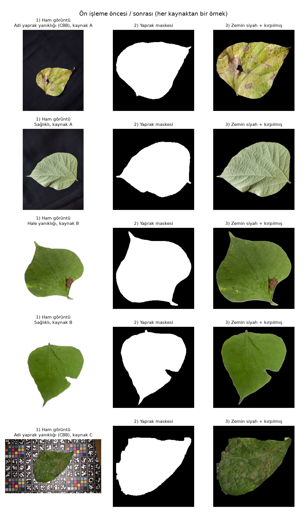
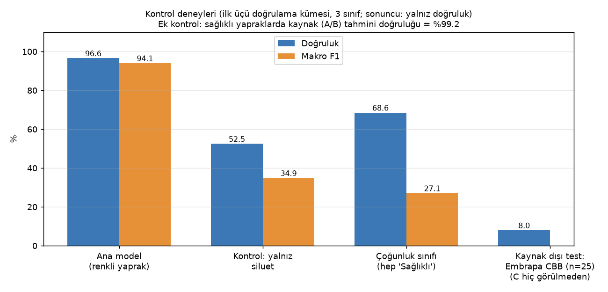
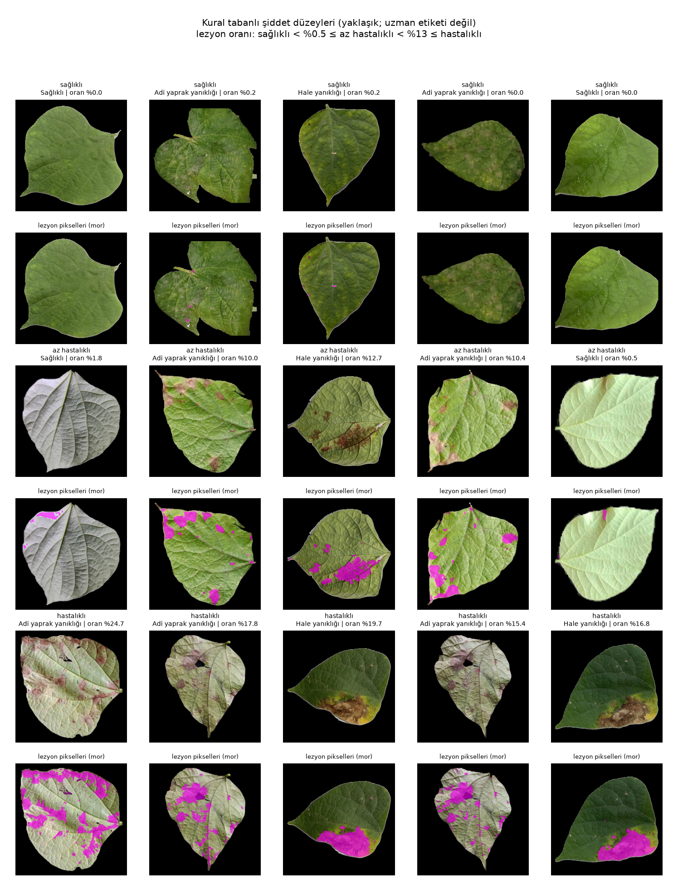

# Fasulye yaprağı hastalık sınıflandırması: sıfırdan tasarlanmış CNN

[](https://github.com/alisimsek55/bean-leaf-disease-cnn/actions/workflows/tests.yml)

[English](README.md)

Fasulye yaprağı fotoğraflarını adi yaprak yanıklığı (CBB), hale yanıklığı ve sağlıklı olarak sınıflandıran, PyTorch ile sıfırdan tasarlanıp eğitilmiş 16 katmanlı bir evrişimli sinir ağı. Üniversitedeki "Tarımda Yapay Zekâ" dersi projesi olarak yapıldı. Doğrulama doğruluğu %97,6; ancak depodaki bölme eğitim ile doğrulama arasında seri çekim kareleri sızdırdığı için bu bir üst sınır (bkz. [Sonuçlar](#sonuçlar)). Reponun asıl ilginç tarafı bu sayıdan sonrası: bunun ne kadarının hastalığı tanımaktan, ne kadarının veri setindeki yapaylıklardan geldiğini test ettim; cevap "başlıktaki sayının düşündürdüğünden az".



## Sonuçlar

Doğrulama kümesi, n = 738 (dHash yakın-kopya gruplarına göre gruplu %70/%30 bölme). Kaynak: [`ciktilar/metrikler.json`](ciktilar/metrikler.json).

> **Bu bölmede bilinen sızıntı.** Eğitim ve doğrulamanın ortak yakın-kopya grubu yok, ama sonradan yapılan denetim ([`scripts/bolme_denetimi.py`](scripts/bolme_denetimi.py)) kaynak A'nın seri çekim karelerinin iki tarafa dağıldığını buldu: 145 çekim saniyesi iki tarafta da var ve kaynak A'nın 314 doğrulama görüntüsünden 299'unun (738'lik doğrulama kümesinin %40,5'i) eğitimde aynı saniyede çekilmiş bir eşi bulunuyor. Bu yüzden aşağıdaki %97,56 doğruluk ve %95,5 makro F1 iyimserdir; bölme seri çekime duyarlı gruplarla yeniden kurulup modeller yeniden eğitilene kadar (planlandı) üst sınır olarak okunmalıdır.

| Ölçüt | Değer |
|---|---|
| Doğruluk | %97,56 (720/738) |
| Dengeli doğruluk | %98,68 |
| Makro F1 | %95,48 |
| Çoğunluk sınıfı tabanı (hep "sağlıklı") | %69,0 doğruluk, %27,2 makro F1 |

| Sınıf | Kesinlik | Duyarlılık | F1 | n |
|---|---|---|---|---|
| CBB | 1,000 | 0,994 | 0,997 | 160 |
| Hale yanıklığı | 0,793 | 1,000 | 0,885 | 69 |
| Sağlıklı | 1,000 | 0,967 | 0,983 | 509 |

Ayrı bir test kümesi yok: doğrulama kümesi erken durdurma ve model seçiminde de kullanıldı, bu yüzden sayılar daha kontrollerden önce de hafif iyimser.

## Doğruluk gerçek mi?

Her sınıfın büyük kısmı farklı bir veri kaynağından ve farklı bir arka plandan geliyor: hale yanıklığının tamamı kaynak B'den, CBB'nin %95'i kaynak A'dan. Ağ hastalığı değil kaynağı tanıyarak da yüksek skor alabilir. Dört kontrol yaptım.

| Kontrol | Ne yapıldı | Sonuç | Ne gösteriyor |
|---|---|---|---|
| Siluet | Aynı model; girdi yalnızca yaprak dış hattı (renk/doku yok) | %52,3 doğruluk, %47,9 makro F1 (çoğunluk tabanı %69,0) | Başarı yaprak şeklinden gelmiyor. |
| Kaynak tahmini | Maskeli sağlıklı yapraklarda aynı CNN, hedef = kaynak (A/B) | %100 (509/509) | Maskeleme zemini kaldırdı ama kaynak imzasını değil. Hale = kaynak B, CBB ≈ kaynak A olduğundan CBB ↔ hale ayrımı kaynaktan ayrılamıyor. |
| Görülmemiş kaynak (Embrapa) | Kaynak C eğitimden çıkarılıp model yeniden eğitildi; 27 Embrapa görüntüsünde test | 25 CBB'den 5'i doğru (%20): 13'ü "hale", 7'si "sağlıklı". Sağlıklı 2/2. Aynı modelin A+B doğrulaması: %99,59. | Hiç görülmemiş kaynağa genelleme zayıf. n küçük (25). |
| Grad-CAM | Son evrişim katmanı (8x8), 738 doğrulama görüntüsü | Lezyon pikselinde medyan zenginleşme: CBB 1,44x, hale 2,65x; yaprak kenarında ~1x. CAM ağırlığının %32-45'i siyah arka plana düşüyor. | Model lekeye bakıyor, ama hastalığa özgü özelliği mi kaynağa özgü leke görünümünü mü kullandığı ayırt edilemiyor. |



**Sonuç.** Aynı kaynak içinde hastalıklı/sağlıklı ayrımı makul görünüyor (sağlıklılarda A'da %100, B'de %95,1; hatalar hale yönünde); ancak kaynak A'da seri çekim sızıntısı olduğundan A'nın sonuçları bilinmeyen bir miktarda şişkin. B ve C'nin dosya adlarında çekim zamanı olmadığından onlar için yalnızca dHash gruplaması geçerli; seri sızıntısı orada ne bulunabiliyor ne dışlanabiliyor. CBB ↔ hale ayrımının hastalıktan geldiği kanıtlanamıyor, çünkü sınıf ile kaynak neredeyse tamamen örtüşüyor; görülmemiş kaynaktaki CBB'de %20 başarı, %97,6'nın aynı kaynaklar içindeki (dağılım-içi) bir sayı olduğunu gösteriyor. Üst sınır olarak okunmalı. İsteğe bağlı ImageNet ön eğitimli EfficientNet-B0 doğrulamada %100 verdi; aynı karışma geçerli olduğundan bu da kanıt değil, ve onun için kaynak dışı test yapılmadı.

## Hat (pipeline)

- **Veri:** 3 açık kaynak, toplam 2 460 görüntü (CBB 533, hale 231, sağlıklı 1 696); 9 hatalı maske dışlandı, 2 451 kaldı. Eğitim/doğrulama: CBB 373/160, hale 162/69, sağlıklı 1 178/509 (toplam 1 713/738). Ayrıntı: [docs/DATASET.tr.md](docs/DATASET.tr.md).
- **Ön işleme:** Model zemini (beyaz PNG / siyah kumaş / kalibrasyon kartı) öğrenmesin diye yaprak maskelenir, arka plan siyaha boyanır, yaprağa kırpılıp 256x256 PNG yapılır (model 128x128 okur). [`src/01_on_isleme.py`](src/01_on_isleme.py)
- **Bölme:** Yakın kopya (dHash) gruplarına göre gruplu, (sınıf, kaynak) katmanlı %70/%30. Ortak grup sayısı 0, ama bu sızıntı olmadığını göstermiyor: kaynak A'da aynı yaprağın seri çekim kareleri dHash eşiğini aşıp ayrı gruplara düştü; [`scripts/bolme_denetimi.py`](scripts/bolme_denetimi.py) 145 ortak çekim saniyesi buldu (A'nın 314 doğrulama görüntüsünden 299'u, doğrulama kümesinin %40,5'i; 2 sn'lik seri penceresiyle 312). [`scripts/yakin_kopya.py`](scripts/yakin_kopya.py) artık aynı kaynak ve sınıfta en çok 2 sn arayla çekilmiş kareleri de aynı gruba alıyor; depodaki bölme ve modeller bu düzeltmeden önceye ait, yeniden bölme ve eğitim planlandı. [`src/02_veri_bolme.py`](src/02_veri_bolme.py)
- **Model:** Önceden eğitilmiş ağırlık yok; 4x4 evrişim + BatchNorm + ReLU blokları (32-64-128-256-256 filtre), 2x2 havuzlama, %20 dropout, global ortalama havuzlama, 128'lik tam bağlı katman, 3 sınıflı çıkış; **1 772 995** parametre. [`src/03_model.py`](src/03_model.py)
- **Eğitim:** Sınıf ağırlıklı çapraz entropi, AdamW (lr 1e-3, wd 1e-4), batch 32, ReduceLROnPlateau, erken durdurma (sabır 15), veri artırma, tohum 42. 50 epoch çalıştı, en iyi epoch 35. [`src/04_egitim.py`](src/04_egitim.py)
- **Şiddet tahmini:** Kural tabanlı, **uzman etiketi değil** (veri setinde şiddet etiketi yok). Lezyon oranı eşikleri T1 = %0,5 ve T2 = %13 (T1'in altı sağlıklı, T1 ile T2 arası az hastalıklı, T2 ve üstü hastalıklı); 2 451 görüntüde sağlıklı 1 716, az hastalıklı 347, hastalıklı 388. [`src/06_siddet_tahmini.py`](src/06_siddet_tahmini.py)



## Sınırlılıklar

1. Kaynak-sınıf karışması (en önemlisi): hale %100 kaynak B, CBB %95 kaynak A; kaynak maskelemeden sonra bile %100 tahmin edilebiliyor. Kaynak dışı CBB başarısı %20.
2. Depodaki bölmede seri çekim sızıntısı: dHash grupları ayrık, ama kaynak A'da 145 çekim saniyesi hem eğitimde hem doğrulamada; A'nın 314 doğrulama görüntüsünden 299'unun (738'in %40,5'i) eğitimde aynı saniyeden eşi var. Raporlanan sayılar ve aynı bölmeyi kullanan kontrol eğitimleri ile EfficientNet-B0 iyimser, özellikle kaynak A için. Gruplama düzeltildi ve [`scripts/bolme_denetimi.py`](scripts/bolme_denetimi.py) bunu denetliyor; yeniden bölme ve eğitim planlandı, henüz yapılmadı. B ve C'de dosya adında zaman damgası olmadığından orada seri sızıntısı denetlenemiyor.
3. Hale yanıklığı etiket güveni düşük: görsel incelemede hale klasörünün yalnızca ~%20-30'u tipik hale belirtisi gösteriyordu; çoğu CBB'ye benziyor. Etiketler değiştirilmedi.
4. Tür belirsizliği: A ve B'deki yapraklar *Phaseolus vulgaris* olmayabilir; yalnızca C kesin.
5. Ayrı test kümesi yok; tek tohum, tek bölme; doğrulama doğruluğu epochlar arasında %85-99 dalgalandı.
6. Az bağımsız örnek: hale 231 görüntü ama 146 farklı yaprak; kaynak A'da 1 057 görüntü ama dHash + seri gruplamasıyla yalnızca 110 grup.
7. Maskeleme kusursuz değil (9 görüntü dışlandı; bazı kart/kumaş artıkları kaldı).
8. Şiddet ölçüsü kural tabanlı ve kaynağa bağımlı.
9. Grad-CAM kaba (8x8); ağırlığın %32-45'i yaprak dışında.
10. Embrapa testi yalnızca 25 CBB + aynı yaprağın 2 sağlıklı karesiyle yapıldı.

Yapılmayanlar: uzman şiddet etiketi, çoklu tohum/çapraz doğrulama, EfficientNet-B0 için kaynak dışı test, `calistir.ps1`'in baştan sona tek parça çalıştırılması (betikler aynı sırayla tek tek çalıştırıldı).

## Sırada ne yapardım

- Bölmeyi seri çekime duyarlı gruplarla yeniden kurmak, `scripts/bolme_denetimi.py` ile denetlemek, tüm modelleri yeniden eğitip raporlanan sayıları değiştirmek.
- Her sınıf için birden fazla kaynaktan veri toplamak (kaynak ile hastalık aynı değişken olmasın) ve kaynak-dışarıda-bırakma ile değerlendirmek.
- Hale etiketlerini bir bitki patoloğuna doğrulatmak ya da sınıfı doğrulanmış bir sınıfla değiştirmek.
- Kaynak dışı testi tüm modellere uygulamak, birden fazla tohumla varyans raporlamak, gerçek bir test kümesi ayırmak.

## Yeniden üretme

Python 3.13; sürümleri sabitlenmiş [`requirements.txt`](requirements.txt) (CUDA 12.8 PyTorch). CPU için torch/torchvision'ı `https://download.pytorch.org/whl/cpu` dizininden kurun; testlerin ihtiyaçları [`requirements-ci.txt`](requirements-ci.txt) içinde.

**Raporlanan koşudan sonraki değişiklikler.** Raporlanan sayıları üreten koşudan sonra kodda düzeltmeler yapıldı; yeni bir koşu sayıları birebir üretmez: (i) değerlendirme artık yeniden boyutlandırmadan sonra yaprak maskesini eğitimdeki gibi yeniden uyguluyor; (ii) en iyi kontrol noktası artık gerçekten en düşük doğrulama kaybı (önceden 1e-4'ten büyük iyileşme gerekiyordu); (iii) gruplama artık seri çekime duyarlı, bu yüzden `yakin_kopya.py` ve `02_veri_bolme` yeniden çalıştırılırsa depodakinden farklı bir bölme çıkar. [`ciktilar/metrikler.json`](ciktilar/metrikler.json) içindeki sayılar ilk koşudandır ve değiştirilmedi.

Veri depoda dağıtılmaz; [`scripts/`](scripts) altındaki betikler indirir ve düzenler (~1,6 GB, hesap gerekmez):

```powershell
python -I scripts/indir.py . mendeley_ykvcrjffzd
python -I scripts/indir.py . mendeley_3km9d246z2
python -I scripts/indir.py . embrapa_pddb
python -I scripts/duzenle.py .
python -I scripts/yakin_kopya.py .        # dHash + seri çekim grupları (`grup` sütunu)
python -I scripts/bolme_denetimi.py .     # 02_veri_bolme'den sonra: sızıntı denetimi (sızıntı varsa çıkış kodu 1)
```

Çalıştırma sırası (ya da `calistir.ps1`; `-EkModel` ile EfficientNet-B0 da): `01_on_isleme`, `02_veri_bolme`, `04_egitim` (ana model; ayrıca `--girdi siluet`, `--gorev kaynak`, `--haric_kaynak embrapa_pddb` kontrolleri), `06_siddet_tahmini`, `07_ek_efficientnet` (isteğe bağlı), `05_degerlendirme`. Tam komutlar [İngilizce README](README.md#reproduce)'de.

Donanım: NVIDIA RTX 4070 Laptop (8 GB), PyTorch 2.11.0+cu128; ana model 1 009 sn'de eğitildi (iki kontrol eğitimi GPU'yu paylaşıyordu). Model ağırlıkları dağıtılmıyor. Proje yolu çok uzunsa Windows'ta bazı DLL'ler yüklenemeyebilir; projeyi kısa bir yola taşıyın.

Testler (veri/GPU gerekmez): `pytest -q`. Depodaki bölmeyi denetleyen test, bilinen seri sızıntısı yüzünden beklenen hata (`xfail`) olarak işaretli; bölme yeniden kurulunca işaret kaldırılmalı.

## Veri kaynakları ve lisanslar

- **A.** Rashid M. R. A., Hasan M., Gani R., Kamara R., Tarin T. K., Rabbi S. F. *Image Dataset for Bean and Cowpea Plant Leaf Disease Detection and Freshness Assessment from Bangladesh.* Mendeley Data v1 (2024), doi:[10.17632/ykvcrjffzd.1](https://doi.org/10.17632/ykvcrjffzd.1); makale: *Data in Brief* (2024), doi:[10.1016/j.dib.2024.111023](https://doi.org/10.1016/j.dib.2024.111023). CC BY 4.0.
- **B.** Mojumdar M. U., Dip S. D., Alahi T. E., Tonmoy S. *Bean Health and Disease Dataset: A Resource for Agricultural Research.* Mendeley Data v3 (2025), doi:[10.17632/3km9d246z2.3](https://doi.org/10.17632/3km9d246z2.3). CC BY 4.0.
- **C.** Barbedo J. G. A. ve ark. *Embrapa PDDB: Base de Imagens de Sintomas de Doenças de Plantas.* doi:[10.48432/XA1OVL](https://doi.org/10.48432/XA1OVL); makale: *IEEE Latin America Transactions* 16(6), 2018, doi:[10.1109/TLA.2018.8444395](https://doi.org/10.1109/TLA.2018.8444395). CC BY-NC 4.0.

`ciktilar/sekiller/` altındaki şekiller bu veri setlerinden türetilmiş görüntüler (maskelenmiş, kırpılmış yaprak fotoğrafları) içerir; aynı lisans koşullarıyla, atıfla ve yalnızca ticari olmayan amaçla paylaşılır. `data/` altındaki CSV'ler yalnızca üst veri içerir, görüntü içermez. Kod [MIT lisansıdır](LICENSE); lisans veri setlerine ve onlardan türetilmiş görüntülere uzanmaz.

## Nasıl yapıldı

Bu projeyi yapay zekâ destekli geliştirmeyle, Claude Code'u eşli programlama aracı olarak kullanarak yaptım. Kapsamı ve gereksinimleri ders yönergesinden ben belirledim: sağlıklı yapraklardan ayrılacak iki hastalık, hazır bir model yerine sıfırdan tasarlanan bir ağ, %70/%30 eğitim/doğrulama bölmesi ve sağlıklı, az hastalıklı ve hastalıklı yaprakların gösterilmesi. Uygulamanın büyük kısmını bu yönlendirmeyle yapay zekâ yaptı. Sınırlılıklar dahil sonuçlar, çıktığı haliyle raporlanmıştır.